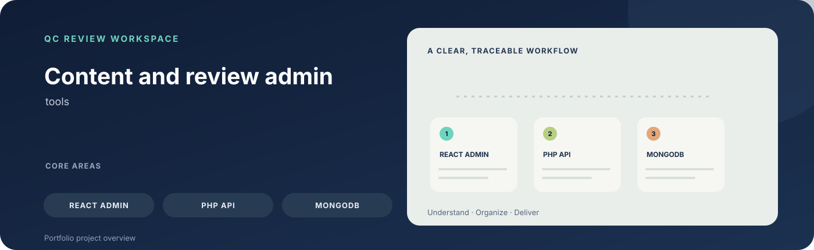

# QC Review Workspace

A web admin interface for managing users, posts, review assignments, todos, and audit logs. The frontend uses React Admin and TypeScript; the repository also includes PHP backend files with MongoDB support and Firebase sign-in components.

## What’s inside

- **Admin interface:** user, post, todo, audit-log, and settings screens.
- **Review workflow:** post assignment and reviewer-related fields.
- **API and storage:** PHP backend setup and MongoDB integration.
- **Authentication:** Firebase components in the frontend.

## Run the frontend

    npm install
    npm run dev

Other available scripts include <code>npm run type-check</code>, <code>npm run build</code>, and <code>npm run serve</code>.

## Backend setup

The Dockerfile uses PHP 8.1 with Apache and installs the MongoDB PHP extension. The Compose file maps the API to port <code>8098</code>, but its volume points to a Windows-specific checkout path. Update that volume to your local backend directory before starting the service.

Review local API URLs and Firebase configuration for your environment. Keep private credentials out of source control.

## Technology

**React Admin** · **React** · **TypeScript** · **Vite** · **PHP 8.1** · **MongoDB** · **Firebase**

---

*Portfolio description based on the source files in this repository.*
